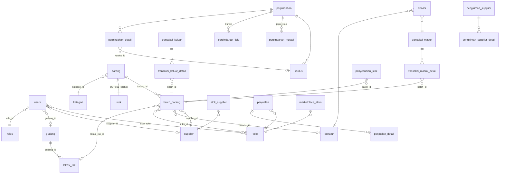
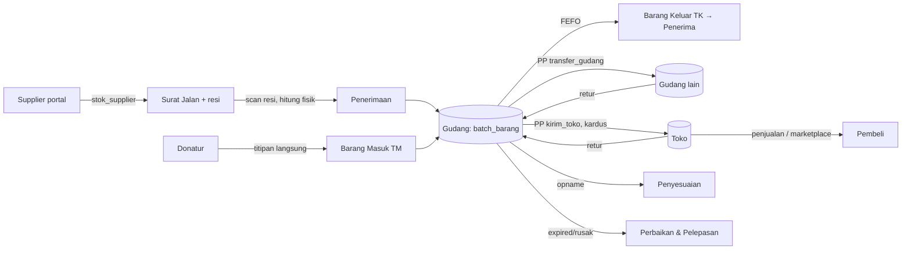

# PRD — AMANAH (Aplikasi Manajemen Amanah & Hibah)

**Versi dokumen:** 1.0 · **Tanggal:** 23 Okt 2026 · **Pemilik produk:** Yayasan Al-Fatihah
**Produksi:** https://kelolaaset.space · **Repo:** `amanah-gudang` (web) + `amanah_android` (terpisah)
**Sumber kebenaran:** dokumen ini diturunkan langsung dari kode (`_lib.php`, `db/instal_database.sql`, header komentar tiap halaman). Bila berbeda dengan kode, kode yang benar — perbarui dokumen ini.

---

## 1. Ringkasan Eksekutif

AMANAH adalah sistem manajemen gudang untuk barang **titipan donatur** dan pembelian lembaga. Ia mencatat barang dari hulu (supplier/donatur) sampai hilir (penerima amanah/toko), dengan prinsip:

1. **Stok hanya berubah lewat dokumen yang disahkan.** Tidak ada angka stok yang bergerak tanpa jejak (nomor dokumen, siapa, kapan, alasan).
2. **Angka yang masuk ke stok adalah angka hasil hitung fisik**, bukan angka di surat jalan.
3. **Barang titipan dijaga sampai ujung:** atribusi donatur ikut batch ke mana pun ia berpindah; pelepasan wajib beralasan; riwayat tidak bisa dihapus.
4. **FEFO** (First-Expired-First-Out) otomatis saat barang keluar.
5. **Aman dipakai bersamaan** oleh banyak petugas (penguncian baris berurutan, transaksi atomik).

Ekosistem: web PHP prosedural (tanpa framework) + aplikasi Android (REST API JWT) + integrasi marketplace (Shopee/Tokopedia) + cadangan otomatis ke Google Drive.

---

## 2. Latar Belakang & Masalah yang Dipecahkan

| Masalah sebelum sistem | Solusi di AMANAH |
|---|---|
| Stok di catatan ≠ stok di rak | Stok hanya berubah via dokumen; opname fisik per rak; selisih wajib beralasan |
| Barang kedaluwarsa tetap terhitung persediaan | Batch & Expired → Perbaikan & Pelepasan; batch tak layak dilewati FEFO |
| "Barang siapa yang dibuang?" tak terjawab | `donatur_id` disalin ke setiap batch & pelepasan, bukan dirujuk |
| Supplier kirim, gudang tak tahu | Portal supplier → surat jalan + resi → gudang scan & hitung fisik |
| Dokumen yang sama diterapkan dua kali | Pemisahan `butuh_penerimaan()`: stok pindah di satu titik saja |
| Dua petugas simpan bersamaan → deadlock | `kunci_stok()` lock ordering: `stok` → `penyesuaian` → `batch_barang` |
| Barcode tertembak ke kotak Jumlah → stok miliaran | `MAKS_QTY_BARIS = 1.000.000` di semua jalur penambah stok |

---

## 3. Pengguna & Peran

### 3.1 Peran (tabel `roles`)

| Peran | Kode | Lingkup | Beranda |
|---|---|---|---|
| Super Admin | `super_admin` | Seluruh sistem | `dashboard.php` |
| Admin Gudang | `admin_gudang` | **Satu gudang** (`users.gudang_id`) | `dashboard.php` |
| Admin Terpadu | `admin_terpadu` | Satu gudang + kelola donatur & titipan langsung | `dashboard.php` |
| Pimpinan | `pimpinan` | Baca-saja seluruh sistem + menyetujui dokumen | `dashboard.php` |
| Supplier | `supplier` | Gudang supplier sendiri (`users.supplier_id`) | `dasbor_supplier.php` |
| Admin Toko | `toko` | Toko yang dipegang (`user_toko`, boleh >1) | `dasbor_toko.php` |

### 3.2 Tingkat (di dalam peran)

`users.tingkat` ∈ {`staff`, `manager`}. **Tingkat hanya membatasi, tidak pernah memberi.** Super Admin & Pimpinan selalu `manager`.

Hal yang butuh tingkat Manager: kelola master data, hapus data, pelepasan barang, ubah penyesuaian yang sudah tercatat, catat barang masuk toko tanpa dokumen, setujui penyaluran langsung mitra→penerima.

### 3.3 Izin per akun (`katalog_izin()`)

Penyimpangan di atas peran+tingkat, diatur Super Admin di Kelola Pengguna. **Izin tidak pernah memperluas lingkup**, hanya membuka tombol/halaman:

`kelola_master` · `hapus` · `lihat_nilai` (rupiah) · `lihat_laporan` · `kontak_donatur` (data pribadi) · `masuk_gudang_toko` · `setujui`

### 3.4 Fungsi penjaga utama (`_lib.php`)

| Fungsi | Jawaban |
|---|---|
| `role_saat_ini()` | peran dari sesi |
| `terikat_satu_gudang()` | admin_gudang ∨ admin_terpadu |
| `boleh_edit()` | super_admin ∨ admin_gudang ∨ admin_terpadu |
| `boleh_setujui($pdo)` | super_admin ∨ pimpinan ∨ izin `setujui` |
| `boleh_setujui_dokumen($pdo,$pp)` | + manager internal untuk `penyaluran` dari `supplier` |
| `boleh_kelola_master($pdo)` | izin `kelola_master`, bawaan: boleh_edit ∧ manager |
| `rak_saya($pdo)` / `gudang_saya()` / `toko_saya()` | daftar ID dalam lingkup |
| `tolak_supplier()` / `tolak_di_luar_peran()` | 403 untuk peran eksternal / halaman di luar lingkup |
| `syarat_perpindahan()` / `syarat_lingkup()` | potongan WHERE lingkup, dipakai di SQL bukan hanya tampilan |

---

## 4. Struktur Navigasi

### 4.1 Peran internal (`grup_navigasi()`)

```
Dasbor
  Ringkasan                 dashboard.php
  Mitra & Lokasi            pengawasan.php          [super, pimpinan]
Transaksi
  Barang Masuk              masuk.php               [bukan pimpinan]
  Barang Keluar             keluar.php              [bukan pimpinan]
  Surat Jalan               perpindahan.php         [bukan pimpinan]
  Penerimaan Barang         penerimaan.php | kiriman_supplier.php
  Kardus                    kardus.php
  Persetujuan               persetujuan.php         (badge: menunggu)
  Stock Opname              opname.php              [bukan pimpinan]
  Transfer Antar Gudang     perpindahan.php?jenis=transfer_gudang   [super]
  Pindah Antar Rak          perpindahan.php?jenis=mutasi_rak        [admin gudang/terpadu]
  Batch & Expired           monitoring.php | batch.php | pelepasan.php
  Scan Resi Paket           scan_resi.php           [super]
  Cek Surat Jalan           cek_surat.php
  Lacak Kiriman             lacak.php               [bukan pimpinan]
Master Data
  Produk                    barang.php
  Kategori                  kategori.php
  Supplier                  supplier.php
  Gudang                    gudang.php | rak.php
  Toko / Outlet             toko.php
  Penerima Amanah           penerima.php
  Donatur                   donatur.php
Laporan
  Laporan                   laporan.php | laporan_donasi.php | laporan_harian_donasi.php | laporan_keluar.php
Pengaturan (via menu pengguna topbar, bukan sidebar)
  pengaturan.php → pengguna.php, pengaturan_aplikasi.php, pengaturan_merek.php,
  migrasi.php, cadangan.php, marketplace.php, impor_data.php, log_aktivitas.php,
  perangkat.php, ganti_password.php, cek_sistem.php
```

### 4.2 Supplier (`menu_supplier()`)

Transaksi: Barang Masuk · Barang Keluar · Pindah Antar Rak → Pengiriman: Surat Jalan · Cek Surat Jalan → Laporan: Batch & Expired · Laporan Stok → Akun: Profil · Perangkat · Aplikasi Android. Semua tab di `dasbor_supplier.php?tab=`.

### 4.3 Toko (`menu_toko()`)

Dashboard · Barang Masuk (`penerimaan.php`) · Barang Keluar (jual) · Scan Resi Paket · Cek Surat Jalan · Impor Pesanan · Pesanan Marketplace · Stok Toko · Gudang Toko · Pindah Antar Rak · Batch & Expired · Laporan Stok · Profil · Perangkat.

Menu tambahan muncul **karena izin** (`menu_izin_tambahan()`): master data & Persetujuan bila akun eksternal diberi izinnya.

---

## 5. Model Data

### 5.1 Entitas inti



### 5.2 Tabel & kolom kunci

| Tabel | Peran | Kolom kunci |
|---|---|---|
| `barang` | katalog produk lembaga | kode, nama, kategori_id, satuan, stok_minimum, is_active, deleted_at |
| `stok` | **cache** total per barang di gudang (toko_id IS NULL) | barang_id (PK), qty_total — di-recalc, bukan di-increment |
| `batch_barang` | unit stok sebenarnya | barang_id, nomor_batch, tanggal_expired, qty_awal, **qty_tersisa**, lokasi_rak_id ⊕ toko_id, kondisi, sumber, donatur_id, supplier_id, harga_beli, kardus_id (legacy) |
| `gudang` | lokasi fisik | kode, nama, **jenis** ∈ pusat/toko/supplier, supplier_id, is_active |
| `lokasi_rak` | rak dalam gudang | gudang_id, kode, kapasitas, deleted_at |
| `transaksi_masuk` (+detail) | dokumen TM | no_transaksi, supplier_id, sumber, donatur_id, catatan, user_id |
| `transaksi_keluar` (+detail) | dokumen TK (penyaluran langsung) | no_transaksi, penerima, untuk_bayi, divisi_cabang, keperluan |
| `perpindahan` (+detail) | dokumen PP/SJ universal | no_perpindahan, no_surat_jalan, jenis, asal_tipe/id, tujuan_tipe/id, status, approved_by/at, alasan_tolak, no_resi, ekspedisi |
| `perpindahan_titik` | titik transit (maks 3) | perpindahan_id, gudang_id, urutan, tiba_at, berangkat_at |
| `perpindahan_mutasi` | jejak batch asal→tujuan per dokumen | batch_asal_id, batch_tujuan_id, qty — untuk pembalikan (`balikkan_mutasi_perpindahan`) |
| `kardus` | paket berlabel QR | kode KRD-…, perpindahan_id, status, kondisi |
| `penyesuaian_stok` | PS: opname & koreksi | batch_id, jenis, qty, alasan, lokasi_tipe, user_id |
| `pelepasan_stok` (migrasi) | buang/jual/perbaikan | batch_id, jenis, qty, alasan, donatur_id (disalin), hasil |
| `kardus_isi` / `kardus_riwayat` | isi & jejak status kardus | kardus_id, perpindahan_detail_id; status_lama/baru, user_id |
| `user_gudang` | wilayah kerja tambahan manager (>1 gudang); `users.gudang_id` tetap gudang utama | user_id, gudang_id |
| `donasi_detail` | rincian barang per donasi | donasi_id, barang_id, qty |
| `donatur` / `donasi` | hulu titipan | nama, hp, jenis; donasi: transaksi_masuk_id, jenis_donasi, cara_terima, ekspedisi, no_resi |
| `penerima` | hilir amanah | nama, jenis ∈ individu/keluarga/lembaga/lainnya |
| `supplier` / `stok_supplier` | mitra & stok di tempat mitra | stok_supplier terpisah dari batch_barang |
| `pengiriman_supplier` (+detail) | rencana kiriman dari portal supplier | status ∈ dijadwalkan/dikirim/tiba/diterima/dibatalkan, no_resi |
| `toko` / `user_toko` | outlet & pemegangnya | marketplace, is_active |
| `penjualan` (+detail) | barang keluar toko | marketplace, status, sumber ∈ manual/impor_csv/api, status_kirim, status_bayar |
| `marketplace_akun` / `_sku` / `_sync_log` / `_tarikan` | integrasi | platform, status token, pemetaan SKU |
| `dokumen_counter` | penomoran per prefix/periode | — |
| `activity_log` | jejak semua aksi | user_id, aksi, modul, ref_id, deskripsi |
| `sesi_perangkat` | batas 3 perangkat/akun | user_id, token, perangkat |
| `pengaturan` | key-value (cadangan, merek, jadwal) | kunci, nilai |
| `login_gagal` | pembatas percobaan masuk (web & API) | email, ip, created_at — dibuat otomatis bila belum ada |
| `reset_sandi` | tautan reset sekali pakai | user_id, token_hash (sha256), sampai, dipakai_at |
| `galat_sistem` | galat runtime berkode, dibersihkan >30 hari | kode, konteks, pesan, berkas, halaman, user_id |
| `mutasi_barang`, `retur`, `stock_opname(_detail)`, `resi_scan_log` | tabel pendukung/legacy | — |
| `notifikasi` | **tidak pernah ditulis** — notifikasi diturunkan dari data (`_notifikasi.php`) | — |

### 5.3 Enumerasi penting

| Domain | Nilai |
|---|---|
| Kondisi batch (`KONDISI_BARANG`) | `baru`, `bekas_layak` (layak salur) · `rusak`, `expired`, `bekas_tidak_layak` (tidak layak — dilewati FEFO penyaluran) |
| Sumber (`SUMBER_BARANG`) | `pembelian`, `donasi` |
| Jenis perpindahan | `penerimaan` (supplier→gudang), `transfer_gudang`, `mutasi_rak`, `penyaluran` (→penerima), `retur` (→supplier), `kirim_toko`, `retur_toko`, `antar_toko` |
| Status perpindahan | `draft` → `menunggu_persetujuan` → (`ditolak` \| `dikirim` → `selesai`) \| `selesai` langsung · `dibatalkan` |
| `butuh_penerimaan(jenis)` = true | penerimaan, kirim_toko, retur_toko, antar_toko, transfer_gudang → status `dikirim`, stok pindah saat penerimaan |
| `langsung_sah(jenis)` = true | mutasi_rak saja — tanpa persetujuan |
| Jenis penyesuaian | `koreksi_tambah`, `koreksi_kurang`, `rusak`, `hilang`, `kedaluwarsa` |
| Status kardus | draft → dikemas → siap_dikirim → dalam_perjalanan → diterima · dibatalkan |
| Prefix nomor dokumen | `TM` masuk · `TK` keluar · `PP` perpindahan · `SJ` surat jalan · `PS` penyesuaian · `KRD` kardus |

---

## 6. Alur Bisnis End-to-End



### 6.1 Barang Masuk (`masuk.php`, `_dokumen_masuk.php`, `masuk_ubah.php`, `api/masuk.php`)

- **Siapa:** super_admin, admin_gudang, admin_terpadu.
- **Alur:** scan/cari barang → keranjang (`assets/keranjang-masuk.js`, draf tersimpan lokal via `draf-formulir.js`) → tiap baris: batch, expired, qty, rak, kondisi, harga → Keterangan Penerimaan (supplier / asal: pembelian|donasi; bila donasi: nama donatur + HP (autocomplete), jenis donasi, cara terima, ekspedisi/resi) → Simpan.
- **Validasi:** CSRF; qty 1..`MAKS_QTY_BARIS`; rak wajib & dalam `rak_saya()`; tanggal expired masuk akal (`tanggal_expired_sah`: 2000-01-01 .. +50 th).
- **Transaksi:** `dengan_nomor_dokumen('TM')` → `kunci_stok(ids sorted)` → insert `transaksi_masuk` → `donatur_cocok_atau_buat()` + insert `donasi` (bila donasi) → per baris `tambah_ke_rak()` (buat/gabung batch) + insert detail → `recalc_stok()` per barang → commit.
- **Efek:** stok gudang bertambah; donatur tercatat di batch; log aktivitas `create transaksi_masuk`.
- **Ubah dokumen** (`masuk_ubah.php`): hanya bila batch masih utuh; selisih diterapkan dengan penguncian yang sama.

### 6.2 Supplier → Gudang (`dasbor_supplier.php`, `kiriman_supplier.php`, `scan_resi.php`, `penerimaan.php`)

1. Supplier catat barang masuk ke `stok_supplier` (tab masuk).
2. Supplier pilih dari kolam "siap kirim" → terbitkan **Surat Jalan** (`perpindahan` jenis `penerimaan`, asal supplier, tujuan gudang) + `pengiriman_supplier` dgn no resi. Stok gudang **belum** berubah.
3. Gudang: `kiriman_supplier.php` lihat daftar; `scan_resi.php` / `cek_surat.php` scan QR/resi → buka dokumen.
4. `penerimaan.php`: petugas **hitung fisik** per baris (`qty_diterima`), catatan selisih, foto opsional → konfirmasi.
5. Transaksi: lock dokumen `FOR UPDATE` → `kunci_stok()` → `terapkan_perpindahan()` buat batch di rak tujuan dengan **angka fisik** (kondisi/sumber/donatur diwarisi) → status `selesai`, kardus → `diterima` → `recalc_stok()`.
- **Siapa boleh terima:** super, terikat_satu_gudang (gudangnya), toko (tokonya). Pimpinan baca-saja.

### 6.3 Perpindahan / Surat Jalan (`perpindahan.php`, `_perpindahan_form.php`, `perpindahan_form.php`, `perpindahan_ubah.php`, `surat_jalan.php`)

- **Buat:** pilih jenis → asal → tujuan (rute divalidasi server-side: jenis ↔ asal_tipe ↔ tujuan_tipe, lingkup gudang) → baris barang (qty, batch pilihan opsional) → kelompokkan ke **kardus** atau tanpa kardus → titik transit (maks 3) → **Simpan draft** / **Kirim untuk persetujuan** / (mutasi_rak: **Pindahkan sekarang**).
- **Stok dipesan:** dokumen `menunggu_persetujuan`/`dikirim` menahan stok (`STATUS_MEMESAN_STOK`); `periksa_stok_dokumen()` menolak bila stok asal − pesanan dokumen lain < diminta. Draft tidak memesan; diperiksa ulang saat dikirim.
- **Persetujuan** (`persetujuan.php`): Super Admin/Pimpinan (atau izin `setujui`; manager internal untuk penyaluran mitra→penerima) → `sahkan_perpindahan()`:
  - lock dokumen; cek status; cek stok;
  - `butuh_penerimaan()` → hanya terbitkan `no_surat_jalan` (SJ), status `dikirim`, `catat_batch_pratinjau()`;
  - selainnya → `terapkan_perpindahan()` langsung, status `selesai`;
  - nomor SJ di-retry 5× dengan jitter bila bentrok UNIQUE.
  - **Tolak** → `ditolak` + alasan. **Batalkan** (`batalkan_perpindahan`): draft/menunggu/dikirim saja — belum menyentuh stok. `selesai` tidak bisa dibatalkan → buat retur.
- **Ubah** (`_perpindahan_ubah.php`): dokumen `selesai` boleh dikoreksi oleh manager; `balikkan_mutasi_perpindahan()` membalik jejak `perpindahan_mutasi`, lalu terapkan ulang — ditolak bila batch tujuan sudah berkurang.
- **Cetak:** `surat_jalan.php` (QR → `cek_surat.php`), `kardus_label.php` (QR per kardus).

### 6.4 Lacak Kiriman (`lacak.php`, `_lacak.php`)

Gudang transit scan QR SJ → tandai **tiba** / **berangkat** di `perpindahan_titik`. **Stok tidak singgah**: tetap milik pengirim sampai diterima di tujuan akhir.

### 6.5 Barang Keluar / Penyaluran (`keluar.php`, `api/keluar.php`, `_rincian_keluar.php`)

- **Siapa:** boleh_edit. Admin multi-gudang wajib pilih gudang asal.
- **Alur:** keranjang barang+qty → penerima (dari master `penerima` atau teks), untuk bayi?, divisi, keperluan, catatan → Simpan.
- **Pra-cek:** `stok_layak_salur()` ≥ diminta (batch tidak layak tidak dihitung).
- **Transaksi:** `dengan_nomor_dokumen('TK')` → `kunci_stok()` → insert TK → per barang `ambil_fefo($hanyaLayak=true, gudang)` (lock batch `FOR UPDATE`, urut expired ASC) → potong `qty_tersisa` → insert detail (batch_id, qty) → `recalc_stok()` → commit.
- **Efek:** stok turun; jejak batch terpakai ditampilkan di flash & `laporan_keluar.php`.

### 6.6 Stock Opname (`opname.php`, `api/opname.php`, `barang_stok.php`)

- **Siapa:** super, admin_gudang, admin_terpadu; rak dalam `rak_saya()`.
- **Alur:** pilih rak → daftar batch → isi qty fisik (kosong = dilewati) + alasan per baris → Simpan.
- **Transaksi:** `kunci_stok(barang dari batch)` → lock batch `FOR UPDATE` → `sesuaikan_batch()` per baris (selisih ≠ 0 **wajib alasan**; tulis `penyesuaian_stok` PS; `periksa_qty_wajar`) → `recalc_stok()`.
- **Ubah penyesuaian** (`_penyesuaian_ubah.php`, `penyesuaian_ubah.php`, `ubah_penyesuaian()`): manager; stok ikut digeser ke batch yang sama; qty 0 = hapus catatan & kembalikan; catatan > `MAKS_QTY_BARIS` = riwayat saja (koreksi barcode).

### 6.7 Batch & Expired → Perbaikan & Pelepasan (`monitoring.php`, `batch.php`, `pelepasan.php`)

- `monitoring.php`: batch H-90/H-30/H-7/hari-H/lewat; stok habis/hampir habis.
- `pelepasan.php` (manager): **perbaikan** (buka → tutup dgn hasil layak/tidak/dijual), **buang** (expired/rusak), **jual**. Batch dikunci `FOR UPDATE`, qty dibatasi sisa, **donatur_id disalin**, alasan wajib, riwayat permanen.
- `alat_nolkan_stok.php`: nolkan massal lewat `sesuaikan_batch()` — gudang saja, bukan stok_supplier.

### 6.8 Toko (`dasbor_toko.php`, `_masuk_gudang_toko.php`, `impor_pesanan.php`, marketplace)

- **Masuk:** terima kiriman gudang (`penerimaan.php`, jenis kirim_toko) atau catat langsung (manager/izin `masuk_gudang_toko`) ke rak gudang toko.
- **Keluar:** penjualan manual, impor CSV (`impor_pesanan.php`), atau tarik API (`cron_marketplace.php`) → `penjualan` + potong stok toko FEFO (`$potongStok`).
- **Marketplace** (`marketplace.php`, `marketplace_auth.php`, `_shopee.php`, `_tokopedia.php`, `_marketplace.php`): satu toko satu kredensial; Shopee = HMAC + OAuth per lapak, Tokopedia = OAuth2 client_credentials; pemetaan SKU (`marketplace_sku`); log sinkron (`marketplace_sync_log`); dorong stok balik ke lapak.
- **Retur ke gudang:** PP jenis `retur_toko`.

### 6.9 Master Data

`barang.php`/`barang_form.php` (buat baris `stok` saat barang baru), `kategori.php`, `gudang.php`/`rak.php` (soft delete), `supplier.php`, `toko.php`, `penerima.php`, `donatur.php` (kontak = data pribadi, izin `kontak_donatur`). Semua: manager/izin `kelola_master`; hapus: izin `hapus`.

### 6.10 Laporan

`laporan.php` (stok per gudang/rak/kategori; nilai rupiah butuh izin `lihat_nilai`), `laporan_donasi.php`, `laporan_harian_donasi.php`, `laporan_keluar.php` (rincian batch per TK), `laporan_export.php` (CSV/XLSX), `dashboard.php` (KPI, Chart.js lokal/offline), `pengawasan.php` (super/pimpinan: dasbor supplier & toko mode baca-saja).

### 6.11 Administrasi

- **Pengguna** (`pengguna.php`): peran, tingkat, gudang/supplier/toko, izin, idle_menit, batas 3 perangkat (`perangkat.php`, `sesi_perangkat`).
- **Pengaturan** (`pengaturan.php`, `pengaturan_aplikasi.php`, `pengaturan_merek.php`): nama/logo lembaga, jadwal cadangan, kunci cron.
- **Migrasi** (`migrasi.php`): jalankan `db/migrasi_*.sql` urut; `db/rollback/`.
- **Cadangan** (`cadangan.php`, `cron_cadangan.php`, `cadangan_google.php`): `.sql.gz` ke `cadangan_berkas/`, unggah Google Drive; dipicu cron hosting (`?kunci=`) atau latar dari footer saat Super Admin login (`?otomatis=1`).
- **Log** (`log_aktivitas.php`): semua `catat_aktivitas()`.
- **Cek Sistem** (`cek_sistem.php`): prasyarat PHP/ekstensi/folder tulis.
- **Galat** (`galat.php`): daftar `galat_sistem` berkode — kode yang tampil di layar pengguna dicocokkan ke sebab aslinya di sini; pesan ke pengguna selalu aman (`pesan_error_aman()`).
- **Alur** (`alur.php`): booklet alur kerja di dalam aplikasi untuk pelatihan petugas.
- **Data contoh / reset** (`data_contoh.php`, `reset_data.php`): hanya lingkungan uji.

---

## 7. Mesin Inti (`_lib.php`) — Kontrak yang Tidak Boleh Dilanggar

| Fungsi | Kontrak |
|---|---|
| `kunci_stok($pdo, $barangIds)` | Kunci baris `stok` **sorted** `FOR UPDATE` **sebelum** menyentuh `batch_barang`. Semua jalur stok wajib memanggilnya. Urutan: `stok` → `penyesuaian_stok` → `batch_barang`. |
| `recalc_stok($pdo, $barangId)` | `stok.qty_total = SUM(batch_barang.qty_tersisa WHERE toko_id IS NULL)`. Selalu dihitung ulang, tidak di-increment. Stok toko dihitung terpisah (`stok_di_toko`, `v_stok_toko`). |
| `ambil_fefo(...)` | `FOR UPDATE`, urut `(expired IS NULL), expired ASC, id ASC`; batch pilihan didahulukan; `$hanyaLayak` lewati kondisi tak layak; **melempar** bila kurang — tidak pernah ambil lebih sedikit diam-diam. |
| `tambah_ke_lokasi()` / `tambah_ke_rak()` | Buat/gabung batch; `kondisi_sah()`, `sumber_sah()`, `periksa_qty_wajar()`. |
| `sesuaikan_batch()` | Lock batch; selisih ≠ 0 wajib alasan; tulis PS; kembalikan selisih. Dipakai opname web, API, barang_stok, alat_nolkan. |
| `nomor_dokumen()` / `dengan_nomor_dokumen(…, $percobaan=5)` | Nomor per prefix/periode; operasi diulang dgn jitter bila bentrok UNIQUE. |
| `sahkan_perpindahan()` | Lock dokumen; cek status & stok; `butuh_penerimaan` → SJ saja; else `terapkan_perpindahan`. Retry nomor SJ. |
| `terapkan_perpindahan()` | FEFO dari asal (gudang: `ambil_fefo`; supplier: `ambil_fefo_supplier`) → buat batch tujuan mewarisi kondisi/sumber/donatur → tulis `perpindahan_mutasi`. |
| `periksa_stok_dokumen()` | Stok asal − pesanan dokumen lain berstatus `STATUS_MEMESAN_STOK` ≥ diminta. |
| `butuh_penerimaan()` / `langsung_sah()` | Lihat §5.3. Mencegah penerapan ganda. |
| `MAKS_QTY_BARIS` = 1.000.000 | Diperiksa di `tambah_ke_lokasi` & `sesuaikan_batch` → semua jalur terjaga. |
| `catat_aktivitas()` | Setiap aksi tulis `activity_log`. |
| `set_flash()` / `pesan_runtime()` / `pesan_error_aman()` | RuntimeException = pesan ke pengguna; Throwable lain = pesan aman + log. |

---

## 8. API Android (`api/`)

- **Auth:** `api/login.php` → JWT 7 hari (`_jwt.php`); `auth_required()` di `_bootstrap.php` **membaca ulang** peran/tingkat/status akun dari DB tiap request (akun nonaktif langsung ditolak). CORS `*`. Respons selalu JSON `{ok, ...}` / `{ok:false, error}`.
- **Lingkup:** `_lingkup.php` (`api_in_rak`, dll) — sama dengan web.
- **Endpoint:** `alur`, `barang`, `dashboard`, `donatur`, `gudang`, `kategori`, `keluar`, `kiriman`, `laporan`, `master`, `masuk`, `monitoring`, `notifikasi`, `opname`, `pelepasan`, `penerimaan`, `pengawasan`, `pengguna`, `perpindahan`, `persetujuan`, `profil`, `rak`, `scan`, `versi_aplikasi`.
- **Prinsip:** API memanggil **fungsi yang sama** dengan web (`tambah_ke_rak`, `sesuaikan_batch`, `kunci_stok`, `susun_notifikasi`) — tidak ada logika bisnis duplikat.
- **Distribusi:** APK di `unduhan/`, versi di `api/versi_aplikasi.php`, tautan `index.php#aplikasi`.

---

## 9. Kebutuhan Non-Fungsional

| Area | Ketentuan (sesuai kode) |
|---|---|
| **Sesi** | Cookie `AMANAHSESS`, HttpOnly, SameSite=Lax, Secure (sadar `X-Forwarded-Proto`); save_path `sesi/` (0700 + `.htaccess` deny); `gc_maxlifetime` 30 hari; idle timeout **per akun** (`users.idle_menit`, bawaan 30 mnt); batas 3 perangkat. |
| **Login** | Email+sandi (hash); **pembatas** (`_pembatas.php`): 5 gagal/email atau 30 gagal/IP per 10 mnt → kunci 10 mnt, berlaku web & API; **reset sandi** tanpa email: Super Admin buat tautan token 24 byte, hash tersimpan, berlaku 60 mnt, sekali pakai (`reset_sandi.php`); ganti sandi sendiri (`ganti_password.php`); batas perangkat per akun (`users.maks_perangkat`, bawaan `MAKS_PERANGKAT`=3). |
| **Keamanan** | CSRF token semua POST (`wajib_csrf`); CSP (`script-src 'self' 'unsafe-inline'`, `object-src 'none'`, `frame-ancestors 'self'`), HSTS, nosniff, X-Frame-Options; `_*.php`, `db/`, `docs/`, `sesi/`, `cadangan_berkas/` tertutup `.htaccess`; lingkup diterapkan di SQL (`syarat_lingkup`) bukan di tampilan; password hash; reset sandi via `reset_sandi.php`. |
| **Konkurensi** | InnoDB; transaksi per dokumen; lock ordering `kunci_stok()`; `FOR UPDATE` pada dokumen/batch; retry nomor dokumen dengan jitter; `recalc` bukan increment. Target: 0 deadlock pada beban campur (lihat `docs/operasional/PANDUAN_INSTALASI.md` §uji). |
| **Integritas** | Soft delete master (deleted_at); FK `ON DELETE SET NULL` untuk akun↔gudang; `donatur_id` disalin ke batch & pelepasan; riwayat PS/pelepasan permanen. |
| **Offline/ketahanan** | Chart.js lokal; draf formulir tersimpan di localStorage (`draf-formulir.js`); tabel opsional dibuat otomatis bila migrasi terlewat (`pastikan_tabel_titik`). |
| **Perangkat** | Scanner barcode/QR via kamera atau HID (`assets/scan.js`, `alat_scan.php`); layout responsif, bottom-sheet dialog di HP. |
| **Cadangan** | Otomatis terjadwal (`pengaturan.cadangan_*`), `.sql.gz`, Google Drive; dipicu cron atau latar. |
| **Hosting** | PHP 7.4+/8.x, MySQL 5.7+/MariaDB 10.4+, Apache/LiteSpeed `.htaccess`; tanpa Composer; unggah manual FTP (`docs/riwayat/PANDUAN_UNGGAH.md`). Dev lokal: Docker (`make up`, port 8080, DB 3307). |
| **Bahasa** | Seluruh UI, kode, komentar, pesan galat: Bahasa Indonesia. |

---

## 10. Notifikasi (`_notifikasi.php`)

Tidak disimpan — **diturunkan saat dibaca** (`susun_notifikasi($pdo, $principal)`), dipakai web (lonceng topbar) & API:

dokumen menunggu persetujuan · kiriman di jalan (penerimaan/kiriman supplier) · batch H-90/30/7/hari-H/kedaluwarsa · stok habis/hampir habis · perbaikan menggantung. Tingkat: `penting` | `waspada` | `info`. Badge sidebar: persetujuan, terima, kiriman.

---

## 11. Matriks Akses Ringkas

| Aksi | super | admin_gudang / terpadu | pimpinan | supplier | toko |
|---|---|---|---|---|---|
| Barang Masuk / Keluar gudang | ✔ | ✔ (gudangnya) | ✖ | ✖ | ✖ |
| Buat surat jalan | ✔ | ✔ | ✖ | ✔ (ke gudang) | mutasi_rak / retur |
| Setujui dokumen | ✔ | penyaluran mitra (manager) / izin | ✔ | ✖ | izin |
| Terima kiriman | ✔ | ✔ (gudangnya) | baca | ✖ | ✔ (tokonya) |
| Opname / penyesuaian | ✔ | ✔ | ✖ | — | — |
| Pelepasan / hapus master | manager | manager/izin | ✖ | ✖ | izin |
| Laporan | ✔ | ✔ | ✔ | stok sendiri | stok sendiri |
| Pengguna / Pengaturan / Migrasi / Cadangan | ✔ | ✖ | ✖ | ✖ | ✖ |
| Nilai rupiah / kontak donatur | ✔ | izin | ✔ | ✖ | ✖ |

---

## 12. Metrik Keberhasilan

- 0 deadlock & 0 kegagalan simpan pada beban campur (uji `tests/`).
- Selisih opname tanpa alasan = 0 (dipaksa sistem).
- Setiap batch yang dilepas punya `donatur_id` bila asalnya donasi.
- Stok cache (`stok.qty_total`) selalu = SUM batch gudang (bisa diaudit `koreksi_angka.php`).
- Waktu simpan dokumen < 2 dtk pada 50 baris.

---

## 13. Pengujian & Migrasi

**Uji (`tests/`, dijalankan via CLI PHP, tanpa framework):** `uji_stok.php` (recalc & lock), `uji_fefo.php` (urutan expired, batch tak layak dilewati, lempar bila kurang), `uji_perpindahan.php` (sahkan/terima/batalkan/balikkan, status), `uji_opname.php` (selisih wajib alasan, PS), `uji_pelepasan.php` (donatur disalin, riwayat permanen). Uji beban campur konkurensi: `docs/operasional/PANDUAN_INSTALASI.md` §uji (target 0 deadlock/100).

**Migrasi (`db/`, dijalankan urut lewat `migrasi.php`, semua idempoten `IF NOT EXISTS`/`INSERT IGNORE`):**
`instal_database.sql` (pasang baru) · `migrasi_skema.sql` (skema penuh portabel) · `migrasi_portabel_mysql` · `migrasi_admin_per_gudang` · `migrasi_role_terpadu` · `migrasi_tingkat_pengguna` (tingkat, izin, `user_gudang`) · `migrasi_donatur` · `migrasi_jenis_donasi` · `migrasi_donatur_cara_terima` · `migrasi_sumber_barang` · `migrasi_kondisi_barang` · `migrasi_tim_gudang_01..04` (jenis donasi masuk, kondisi rusak/expired, kardus, keperluan keluar) · `migrasi_status_dibatalkan` · `migrasi_mutasi_perpindahan` · `migrasi_titik_transit` · `migrasi_pelepasan_stok` · `migrasi_rak_supplier` · `migrasi_marketplace` · `migrasi_tokopedia` · `migrasi_pengaturan_merek` · `migrasi_login_gagal` · `migrasi_reset_sandi` · `migrasi_galat_sistem` · `migrasi_indeks_2026_09`. Rollback: `db/rollback/`.

Beberapa tabel juga **dibuat sendiri oleh kode** bila migrasi terlewat (`login_gagal`, `galat_sistem`, `perpindahan_titik`, `pengaturan`) — hosting FTP tidak boleh jatuh ke "tanpa fitur" diam-diam.

---

## 14. Di Luar Lingkup / Batasan Diketahui

- Tidak ada akuntansi/penilaian persediaan (harga_beli hanya informasi).
- Notifikasi push tidak ada (hanya tarik saat dibuka).
- Marketplace: hanya Shopee & Tokopedia yang punya API; TikTok/Lazada manual/CSV.
- Kardus tidak punya stok sendiri — isinya baris perpindahan biasa.
- Gudang transit tidak menerima/mengirim ulang — hanya menandai tiba/berangkat.
- Deploy manual (tanpa CI/CD).

---

## 15. Rujukan

`README.md` · `DESIGN.md` · `docs/operasional/PANDUAN_INSTALASI.md` · `docs/riwayat/PANDUAN_UNGGAH.md` · `docs/SPESIFIKASI_HOSTING.md` · `docs/CATATAN_REVISI_*.md` · `docs/CATATAN_KARDUS_DAN_CADANGAN_2026-10.md` · `docs/ANALISIS_KEKURANGAN.md` · `alur.php` (booklet alur dalam aplikasi) · `tests/uji_*.php`.
